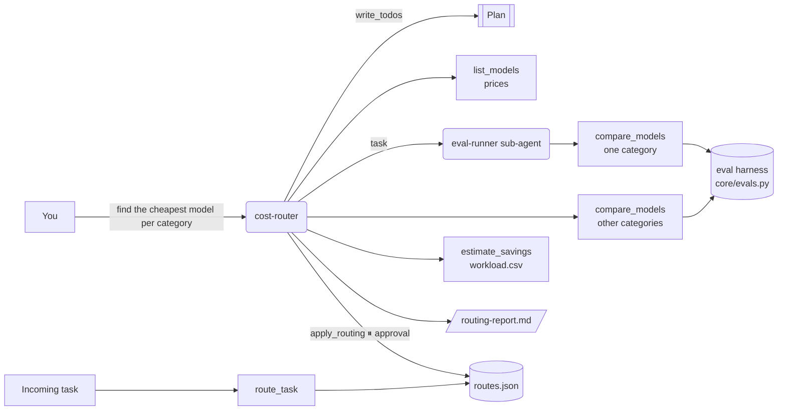

# 1 · Model cost router (`cost-router`)

> Send each task to the cheapest model that still passes your quality tests, and prove it with evals.

Most teams run every request on their most capable (and most expensive) model. The router measures, per
task category, which models clear your quality bar, then routes each category to the cheapest one that does,
and shows the monthly saving before anything changes in production.

## How it works



1. **Plan** the work with `write_todos`.
2. **Know the options**: `list_models` reads the catalog (`examples/models.yaml` or `MODEL_CATALOG`), with
   USD prices per million input/output tokens.
3. **Measure**: `compare_models` runs the eval suite for a category against every candidate (or the ones you
   name), sorts by cost per request and marks which meet the suite's `threshold`. Categories can be delegated
   to the `eval-runner` sub-agent so several are worked on in isolation.
4. **Quantify**: `estimate_savings` applies proposed routes to your monthly workload
   (`examples/cost_router/workload.csv`) and compares with today.
5. **Report** to `/routing-report.md` in the agent's virtual filesystem (visible in the UI's Files tab).
6. **Change production only with approval**: `apply_routing` pauses for a human; once approved it writes
   `routes.json` in the data directory. `route_task` then classifies incoming tasks and uses the table.

## Tools

| Tool | What it does | Needs approval |
|---|---|---|
| `list_models` | Catalog with prices, context window and tags | |
| `list_eval_suites` | Suites under `examples/evals/` with their categories and thresholds | |
| `run_eval(model_name, suite_path, category)` | One model on one suite/category: pass rate, p50/p95 latency, cost, failed cases | |
| `compare_models(category, suite_path, models)` | Many models, sorted by cost per request, cheapest passing named | |
| `route_task(task)` | Keyword-classifies a task (`routing_rules.yaml`) and returns the routed model | |
| `show_routes` | The current routing table | |
| `apply_routing(category, model_name, reason)` | Writes a route to the production table | **yes** (approve / edit / reject) |
| `estimate_savings(routes_json, workload_path)` | Monthly cost now vs. with routes | |

Every run is also appended to `eval_history.json` in the data directory, so you can track drift.

## Sub-agents

- **eval-runner**: evaluates all candidates on one category and reports the cheapest passing model, its pass
  rate, cost per request and latency. Tools: `compare_models`, `run_eval`, `list_models`.

## Inputs

- **Model catalog** (`examples/models.yaml`): `name, provider, model, base_url, api_key_env, input_per_mtok,
  output_per_mtok, context_window, tags`. The `mock` entries are simulated models (`sim_skill`,
  `sim_latency_ms`) so everything runs offline.
- **Eval suite** (`examples/evals/general.yaml`): cases with `id, category, prompt, expected, grader`
  (`exact | contains | regex | number | json_key | any_of`) and a suite `threshold`. **Replace the sample with
  prompts from your own traffic**; routing decisions are only as good as the eval set.
- **Workload** (`examples/cost_router/workload.csv`): `category, monthly_requests, avg_input_tokens,
  avg_output_tokens, current_model`.
- **Routing rules** (`examples/cost_router/routing_rules.yaml`): keywords per category for `route_task`.

## Example prompts

- "Find the cheapest model for each task category in our general eval suite and estimate the savings."
- "Which model should handle: 'Classify the sentiment of this support ticket'?"
- "Compare mock-small and mock-medium on reasoning tasks."
- "Re-run the coding category with a 0.9 threshold and tell me what changes."

## With real models

Add real entries to a catalog file and point `MODEL_CATALOG` at it:

```yaml
models:
  - {name: nai-llama-70b, provider: openai_compatible, model: llama-3-3-70b, base_url: https://nai.example.com/api/v1,
     api_key_env: NAI_API_KEY, input_per_mtok: 0.0, output_per_mtok: 0.0}
  - {name: nai-llama-8b,  provider: openai_compatible, model: llama-3-1-8b,  base_url: https://nai.example.com/api/v1,
     api_key_env: NAI_API_KEY, input_per_mtok: 0.0, output_per_mtok: 0.0}
  - {name: claude-haiku, provider: anthropic, model: claude-haiku-4-5, api_key_env: ANTHROPIC_API_KEY,
     input_per_mtok: 1.0, output_per_mtok: 5.0}
```

For on-prem endpoints such as Nutanix Enterprise AI, set the price to your amortized cost per million tokens
(GPU hours ÷ tokens served) so on-prem and cloud models compare fairly. When a real provider is configured,
`mock` catalog entries are ignored as long as at least one real entry exists.

## Limits and ideas

- Category classification in `route_task` is keyword-based on purpose (cheap, explainable). Swap in a small
  classifier model when categories get fuzzy.
- Each case runs once; for noisy models raise sample counts or use several cases per behavior.
- Ideas: latency SLOs as a second constraint, per-tenant routing tables, exporting routes to a LiteLLM or
  gateway config.
