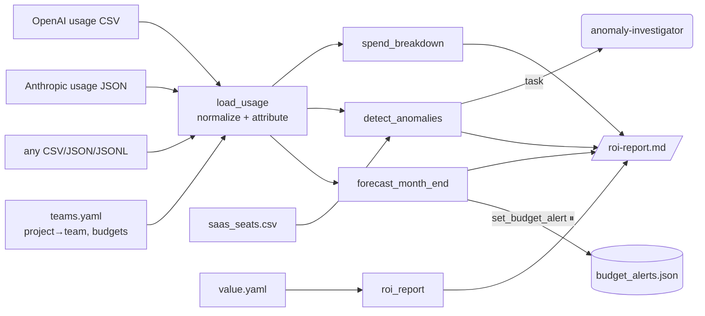

# 2 · AI spend & ROI governor (`spend-governor`)

> Turn raw AI usage and billing exports into accountable numbers: who spends what, what is wasted, what it returns.

## How it works

- `load_usage` accepts exports from any provider: columns are normalized through an alias table (e.g.
  `usage_date|date`, `workspace|project`, `request_count|requests`, `cost.amount|cost_usd`), then each row
  is attributed to a team through `teams.yaml`. Rows nobody owns are reported as **unattributed spend**.
- `detect_anomalies` runs five checks:
  1. **Spend spikes**: robust z-score (median absolute deviation) of daily spend per team.
  2. **Model overkill**: frontier models producing tiny outputs (classification-like traffic).
  3. **Unattributed spend**: keys/projects with no owner.
  4. **Idle seats**: SaaS AI seats under 30% active.
  5. **Overlapping tools**: two tools of the same category in one team.
- `forecast_month_end` projects month-to-date run rate against budgets; `roi_report` estimates value from
  team-owned assumptions (`minutes_saved_per_request × hourly_rate × success_rate`) and labels it an estimate.

## Tools

| Tool | What it does | Approval |
|---|---|---|
| `load_usage(paths)` | Ingest + normalize + attribute exports (comma-separated paths) | |
| `spend_breakdown(dimension, top, month)` | By team, project, model, provider, api_key, user, day or month | |
| `detect_anomalies(z_threshold)` | The five waste/anomaly checks, with $ impact and the fix | |
| `forecast_month_end(month)` | Projected vs. budget per team | |
| `roi_report(month)` | Estimated value vs. spend per team | |
| `list_budget_alerts` | Current alerts | |
| `set_budget_alert(team, monthly_limit_usd, action)` | notify / throttle / block | **yes** |

## Sub-agents

- **anomaly-investigator**: explains the top findings (cause, monthly $ impact, fix).

## Sample data (`examples/spend_governor/`)

Two months of synthetic usage for seven projects with planted problems: a runaway batch job on two days
(data-science), a frontier model used for classification (support-bot), a temporary key nobody owns, idle
Copilot seats in finance, and marketing paying for both ChatGPT Team and Claude Team.

## Example prompts

- "Analyze our AI spend from the sample exports and write an ROI report."
- "Which teams will go over budget this month, and why?"
- "Where are we wasting money on AI tools and seats?"
- "Load `spend_governor/usage_openai.csv` only and break spend down by model."

## Using your own exports

Drop files under the data directory (`APP_DATA_DIR`) or `examples/`, then ask the agent to load them by
relative path. Typical sources: the OpenAI organization usage/costs export, the Anthropic Console usage
export, a LiteLLM or gateway spend log, Nutanix Enterprise AI endpoint metrics joined with your GPU cost per
hour, and a SaaS management export for seats. Edit `teams.yaml` (ownership and budgets) and `value.yaml`
(ROI assumptions, owned by each team).

## Limits and ideas

- ROI is only as honest as `value.yaml`; the agent states this in every report.
- Budget alerts are written to a JSON policy file; wire it to your gateway (LiteLLM budgets, Kong rate
  limits) to enforce.
