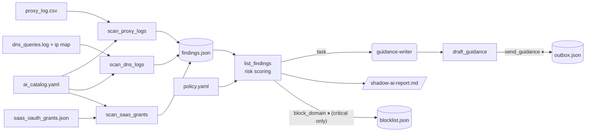

# 3 · Shadow-AI discovery (`shadow-ai`)

> Find unsanctioned AI tool use in network and SaaS logs, rank the risk, and move people to approved tools.

## How it works

Risk score per user × tool (levels: low < 4 ≤ medium < 7 ≤ high < 9 ≤ critical):

| Signal | Points |
|---|---|
| Unsanctioned tool | +3 |
| Vendor may train on inputs | +2 |
| Data residency `cn` or unknown | +2 |
| Unknown vendor | +2 |
| Large uploads (≥ `large_upload_bytes`) | +2 |
| Sensitive department (finance, legal, hr) | +2 |
| OAuth grant to company data (drive, mail, calendar...) | +3 |

## Tools

| Tool | What it does | Approval |
|---|---|---|
| `scan_proxy_logs(path)` | Secure web gateway / proxy export (CSV/JSON): per user × AI tool, requests and bytes out | |
| `scan_dns_logs(path, ip_map)` | BIND-style query logs, client IP mapped to users | |
| `scan_saas_grants(path)` | IdP/SaaS OAuth grant export | |
| `list_findings(min_risk, unsanctioned_only)` | Ranked findings with reasons and the approved alternative | |
| `draft_guidance(user)` | A kind, specific message per user | |
| `send_guidance(user, subject, message)` | Queues the message (simulated outbox) | **yes** (edit allowed) |
| `block_domain(domain, reason)` | Adds to the blocklist file for your gateway | **yes** |

## Sub-agents

- **guidance-writer**: drafts the message for one user without shaming them.

## Inputs

- `ai_catalog.yaml`: domain → tool, vendor, category, `sanctioned`, `trains_on_inputs`, `region`.
  The vendor facts in the sample are illustrative: verify them against current vendor terms.
- `policy.yaml`: approved alternative per category, sensitive departments, upload threshold, risky OAuth scopes.
- Logs: any proxy export with `user, department, dest_host, bytes_out` (Zscaler, Netskope, Squid,
  Palo Alto exports map easily), DNS query logs, and OAuth grant exports (Entra ID, Google Workspace).

## Example prompts

- "Scan the sample proxy, DNS and SaaS logs for shadow AI and write a report."
- "Who in finance or legal is uploading files to unapproved AI tools?"
- "Draft guidance for d.patel about the PDF summarizer."

## Limits and ideas

- Domain matching is suffix-based; add CASB categories for long-tail tools. Unknown hosts that look like AI
  (`ai`, `gpt`, `llm`, `chat` labels) are surfaced for triage.
- Messages and blocks are simulated files: connect `send_guidance` to email/Teams and `block_domain` to your
  SWG API when you trust the flow.
- High demand for an unsanctioned tool is a signal to approve one: the report calls that out.
