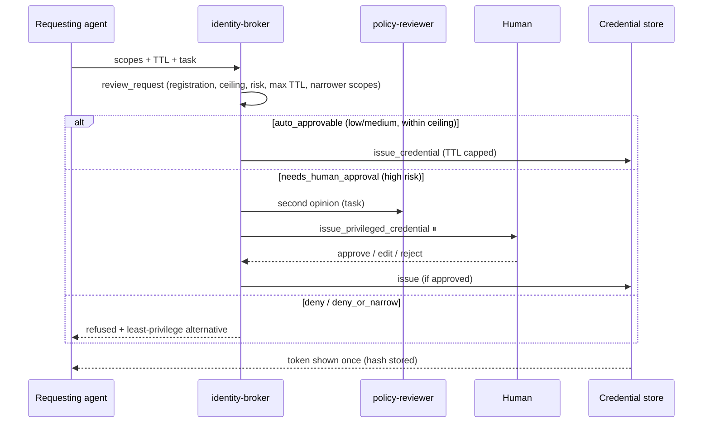

# 4 · Agent identity & permissions broker (`identity-broker`)

> Other agents ask for access; the broker grants the least privilege that does the job, for the shortest time.

## How it works

Policy (`examples/identity_broker/`):

- `scopes.yaml`: every grantable scope with `risk` (low/medium/high/critical), `max_ttl_minutes` and
  `narrower` alternatives (e.g. `crm:export → crm:read`, `email:send → email:draft`).
- `agents.yaml`: registered agents, their human owner and their scope **ceiling**.
- `requests.json`: a sample queue (a fine request, an over-broad one, a production read, an IAM grab and a
  wildcard from an unknown agent).

Verdicts: `auto_approvable`, `needs_human_approval`, `deny_or_narrow` (over ceiling), `deny` (wildcard,
unknown scope, unregistered agent). **Critical scopes are never issued** by the broker (break-glass only).

## Tools

| Tool | What it does | Approval |
|---|---|---|
| `list_scope_catalog` | The scope catalog | |
| `list_pending_requests(path)` | The request queue | |
| `review_request(agent, scopes, ttl_minutes, task)` | Least-privilege review | |
| `issue_credential(agent, scopes, ttl_minutes, request_id)` | Low/medium scopes only | |
| `issue_privileged_credential(agent, scopes, ttl_minutes, justification, request_id)` | High-risk scopes | **yes** |
| `list_credentials(active_only)` | Credentials without tokens; expiry applied | |
| `verify_token(token, scope)` | What a resource server would check | |
| `revoke_credential(credential_id, reason)` | Immediate revocation (safe, no approval) | |
| `audit_log(limit)` | Every review, issue and revoke | |

Tokens are random (`nda_sim_…`), returned once, and only their SHA-256 is stored, as a real broker would.

## Sub-agents

- **policy-reviewer**: strict review of one tricky request with a minimal-scope proposal.

## Example prompts

- "Process the pending access requests from our agents."
- "release-bot needs to push the 2.4.1 release branch. Issue what it needs."
- "Review: data-analyst wants db:prod:read for 2 hours to refresh the churn dashboard."
- "Revoke every credential issued to support-agent."

## Making it real

Replace `_issue` in `agents/identity_broker/tools.py` with your issuer: HashiCorp Vault (dynamic secrets /
token roles), cloud STS (AWS `AssumeRole` with session policies, Azure managed identity, GCP short-lived
tokens), SPIFFE/SPIRE SVIDs, or OAuth token exchange (RFC 8693). Keep the review and approval flow as is.
