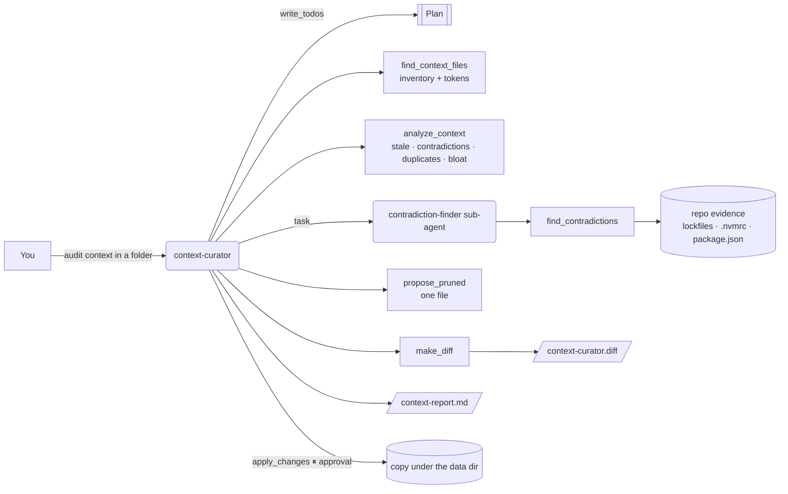

# 6 · Agent context and memory curator (`context-curator`)

> Keep AGENTS.md, CLAUDE.md, .cursorrules and memory files lean, current and consistent.

Coding agents read their instruction files on every request. Over time these files rot: they point at
folders that were deleted, say "use npm" in one file and "use pnpm" in another, repeat the same rules in
four places and fill up with generic advice ("always write clean code"). That costs tokens on every call
and makes agents do the wrong thing. The curator audits every context file in a folder, decides
contradictions with evidence from the repo itself, and proposes a pruned version as a unified diff.

## How it works



1. **Inventory**: `find_context_files` lists the files it knows (below) with size and an estimated token
   count (characters ÷ 4).
2. **Audit**: `analyze_context` returns every finding with `file:line`:
   - **stale**: references to paths that don't exist (backticked or bare `dir/file.ext` tokens, checked
     relative to the root and to the file), "last updated / reviewed" dates older than a year, end-of-life
     runtimes (Node < 18, Python < 3.9, …), and TODO/FIXME/TBD markers. Lines that *say* something was
     removed ("the old folder is gone") are not flagged.
   - **contradictions**: mutually exclusive tool choices (npm/pnpm/yarn/bun, jest/vitest/mocha/pytest,
     prettier/biome, poetry/uv/pipenv/conda), conflicting versions (Node 16 vs 20), and `always X` vs
     `never X` rules. Prohibitions ("never run npm install") count for the other side, and dated decision-log
     entries in `memory/` are history, not instructions. Each contradiction gets a **resolution**: the side
     the repo supports (lockfile, `packageManager`, `.nvmrc`, `engines`, the `test` script) or, without
     evidence, the first canonical file that states it, flagged `needs_human`.
   - **duplicates**: the same normalized line (≥ 20 chars) in several places; the first occurrence in
     canonical order is kept.
   - **bloat**: files over `max_file_tokens` (default 400) or with five or more lines of generic advice.
3. **Contradiction review** is delegated to the `contradiction-finder` sub-agent, which explains each
   conflict with evidence.
4. **Propose**: `propose_pruned(path)` shows one file's new text and every change with its reason;
   `make_diff(root)` writes one unified diff (Python `difflib`) for all files to `/context-curator.diff` in
   the agent's files and to `context_curator/<root>.diff` in the data directory.
5. **Report** to `/context-report.md`: token totals before/after, contradictions with the chosen side,
   stale items, duplicates, bloat and what needs a human decision.
6. **Apply only with approval**: `apply_changes` pauses for a human.

### What pruning does

In canonical order (AGENTS.md first, then CLAUDE.md, Copilot, Cursor, memory), for each line:

| Line | Action |
|---|---|
| Duplicate of a line kept in an earlier file (or earlier in the same file) | removed |
| Points at a path that doesn't exist, or is a TODO/FIXME/TBD | removed |
| Generic filler ("Always write clean code", "You are an expert…", "Remember: …") | removed |
| Losing side of a tool/version contradiction | rewritten (`npm install` → `pnpm install`, `Node 16` → `Node 20`) |
| Losing side of an always/never rule | removed |
| Stale "last updated" date | set to today (the curated version is the reviewed one) |

Headings left empty are dropped and blank-line runs collapsed. Nothing is written until `apply_changes`.

## Tools

| Tool | What it does | Needs approval |
|---|---|---|
| `find_context_files(root)` | Context files with kind, lines, bytes and token estimate | |
| `read_context_file(path, root)` | One file with line numbers, for quoting evidence | |
| `analyze_context(root, max_file_tokens)` | Full audit (stale, contradictions, duplicates, bloat) and summary; saved to `context_curator/<root>-analysis.json` | |
| `find_contradictions(root)` | Contradictions only, with repo evidence | |
| `propose_pruned(path, root)` | Pruned text of one file and every change with its reason | |
| `make_diff(root)` | Unified diff of all proposed changes → `/context-curator.diff` | |
| `apply_changes(root, paths)` | Writes the pruned files (all, or a comma-separated subset) | **yes** (approve / edit / reject) |

## Sub-agents

- **contradiction-finder**: reviews contradictions across the files and says which side the repo supports
  or that a human must decide. Tools: `find_contradictions`, `read_context_file`.

## Human in the loop

`apply_changes` is the only tool that writes to disk and always pauses. **Where it writes:**

- If `root` lives under the data directory (`APP_DATA_DIR`), the files are changed **in place**.
- Otherwise the folder is **copied** to `<data dir>/context_curator/applied/<name>-<timestamp>/` and the copy
  is changed. Files under `examples/` (or any other root) are never modified.

To curate a real repository in place, clone or copy it under the data directory first
(e.g. `var/repos/my-service`) and pass that path as `root`.

## Inputs

Files recognized under `root` (in canonical order): `AGENTS.md`, `CLAUDE.md`,
`.github/copilot-instructions.md`, `.cursorrules`, `.cursor/rules/*.md|*.mdc`, `.windsurfrules`, `GEMINI.md`,
`CONVENTIONS.md`, `memory/*.md`, `.claude/*.md`, `docs/agents/*.md`.

`root` must resolve under the examples or data directory (`core.data.resolve_input`); anything else is
refused. The sample repo `examples/context_curator/sample_repo/` is deliberately messy:

- npm (AGENTS.md, .cursorrules) vs pnpm (CLAUDE.md, Copilot) — `pnpm-lock.yaml` and `packageManager` say pnpm
- Node 16 / 18 / 20 across three files — `.nvmrc` says 20
- jest vs vitest — `package.json` runs jest
- "Never use default exports" ×4 vs "Always use default exports" in .cursorrules (no evidence: needs a human)
- stale paths `src/rules/discounts.ts`, `docs/architecture.md`, `src/legacy/payments.js`, `src/handlers/`,
  `scripts/deploy-staging.sh`; 2023 review dates; TODO/FIXME/TBD
- the architecture paragraph and code-style rules duplicated between AGENTS.md and CLAUDE.md; a bloated
  `.cursorrules`
- real `src/` files so path checks have something to find

## Example prompts

- "Audit the agent context files in context_curator/sample_repo and propose a pruned version."
- "Which instructions in context_curator/sample_repo contradict each other?"
- "How many tokens do our agent instruction files cost, and what can we cut?"
- "Apply only the CLAUDE.md changes."

## Configuration

| Setting | Effect |
|---|---|
| `APP_DATA_DIR` | Where analyses, diffs and applied copies go; roots under it are edited in place |
| `APP_EXAMPLES_DIR` | Second allowed root for reading |
| Module constants in `tools.py` | `CONTEXT_PATTERNS`, `CHOICE_GROUPS`, `EOL_BELOW`, `STALE_DATE_DAYS` (365), `DEFAULT_MAX_FILE_TOKENS` (400) |

## With real models

The tools are deterministic; the model plans, delegates, judges `needs_human` contradictions and writes the
report. Any tool-calling model works:

```bash
export LLM_PROVIDER=openai_compatible
export LLM_BASE_URL=https://nai.example.com/api/v1     # Nutanix Enterprise AI, vLLM, LiteLLM, ...
export LLM_API_KEY=...                                 # NAI: an API key created for the endpoint
export LLM_MODEL=llama-3-3-70b                         # NAI: the endpoint name
uv run nai-agents run context-curator "Audit context_curator/sample_repo and propose a pruned version"
```

Use `--no` to reject every approval (audit only) or `--yes` in a sandbox.

## Limits and ideas

- Contradiction detection is lexical. It catches tool choices, versions and always/never pairs with the
  same object, not paraphrases ("prefer pnpm" vs "npm is the standard here" is only a choice conflict
  because both name a package manager). The model and sub-agent are there to judge the rest.
- Token counts are estimates (chars ÷ 4); swap in a real tokenizer for exact numbers.
- Ideas: a CI check that fails when context grows past a budget, folding duplicated rules into AGENTS.md
  and replacing copies with "see AGENTS.md", and checking that commands named in the files exist in
  `package.json` / `Makefile`.
