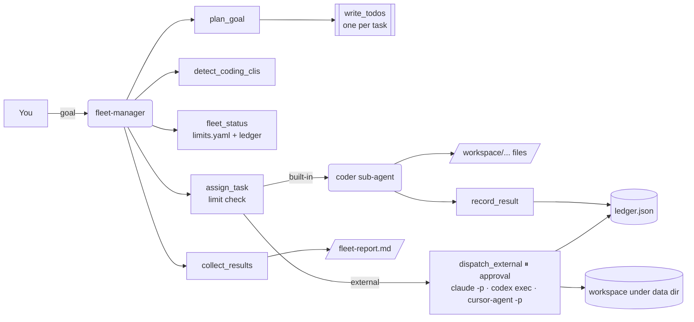

# 7 · Coding-agent fleet manager (`fleet-manager`)

> Split a coding goal into tasks and run each on the right coding agent, inside every agent's budget.

Teams now have several coding agents — Claude Code, Codex, Cursor's CLI — each with its own price, rate
limits and strengths. The fleet manager plans a goal into small tasks, picks an agent for each, refuses work
that would blow a daily limit, keeps a cost ledger and collects the results in one report. When external
CLIs are disabled (the default) or not installed, its own built-in `coder` sub-agent does the work.

## How it works



1. **Plan**: `plan_goal` reads a goal file (or text). Bullets under a "Tasks" heading become tasks; with no
   such heading, all bullets, or sentences. Each task gets an id (`t1`…), a kind (`code`, `test`, `docs`) and
   an estimated token budget. "Constraints" bullets are returned separately.
2. **Know the fleet**: `detect_coding_clis` checks `PATH` for `claude`, `codex` and `cursor-agent` (nothing is
   executed); `fleet_status` shows today's tasks, tokens and dollars per agent against its limits.
3. **Assign**: `assign_task` picks an agent (`auto`: an installed, enabled external CLI with room — cheapest
   output price first for docs — else `builtin-coder`), checks the daily task count, daily tokens and the
   per-task maximum, and records a reservation in the ledger. Over-limit work is **refused**, not queued.
4. **Run**:
   - built-in: the `task` tool with `subagent_type="coder"`; the coder writes files in the agent's virtual
     filesystem (`/workspace/...`), then `record_result` books tokens and cost;
   - external: `dispatch_external` (approval required) runs the CLI non-interactively. If it comes back
     `blocked` (disabled, not installed, over limit) the manager falls back to the built-in coder.
5. **Collect**: `collect_results` lists every task with its attempts (e.g. `codex:blocked,
   builtin-coder:done`), files, cost and totals per agent; the report goes to `/fleet-report.md`.

## Tools

| Tool | What it does | Needs approval |
|---|---|---|
| `plan_goal(goal)` | Goal file or text → tasks (id, kind, estimated tokens) and constraints | |
| `detect_coding_clis()` | Which CLIs are on `PATH` and whether external runs are enabled | |
| `fleet_status(limits_path)` | Usage today vs. limits per agent, tasks by status, cost today | |
| `assign_task(task_id, task, agent, estimated_tokens, limits_path)` | Limit check + reservation; says how to run it | |
| `dispatch_external(task_id, agent, prompt, timeout_s)` | Runs `claude -p`, `codex exec` or `cursor-agent -p` in a confined workspace | **yes** (approve / edit / reject) |
| `record_result(task_id, status, summary, files, input_tokens, output_tokens)` | Books a built-in coder result | |
| `collect_results()` | Today's tasks, attempts, files, cost per agent | |

## Sub-agents

- **coder**: the built-in coding agent. Gets one self-contained task (goal, constraints, files to write) and
  writes the code with `write_file`. It has only the built-in file tools.

## Human in the loop

Every external CLI run pauses for approval, showing the agent and the full prompt (you can edit the prompt
before approving). Rejecting leaves no trace in the ledger; the manager falls back to the built-in coder.

### Safety of external runs

- Off unless `APP_ENABLE_EXTERNAL_CLI=true`.
- Fixed argument lists per CLI (`[exe, "-p", prompt]`, `[exe, "exec", prompt]`), **no shell**, stdin closed.
- Working directory: `<data dir>/fleet_manager/workspaces/<task_id>/`; task ids are restricted to
  `[A-Za-z0-9_-]{1,40}`, so they can't escape it.
- Timeout: `default_timeout_s` from `limits.yaml` (900 s), capped at 3600 s.
- Tokens for external runs are estimated from prompt and output length (chars ÷ 4); the CLIs' own usage
  reports are not parsed yet.

The CLIs themselves still act with your credentials and their own permission settings: run the server in a
sandbox (container, VM) when you enable them.

## Inputs

- **Goal** (`examples/fleet_manager/goal.md`): Markdown with a `# Title`, a `## Tasks` bullet list and an
  optional `## Constraints` list.
- **Limits** (`examples/fleet_manager/limits.yaml`):

```yaml
default_timeout_s: 900
agents:
  builtin-coder: {kind: builtin, daily_tasks: 40, daily_tokens: 400000, max_tokens_per_task: 60000,
                  input_per_mtok: 0.80, output_per_mtok: 3.20}
  claude:        {kind: external, daily_tasks: 25, daily_tokens: 2000000, max_tokens_per_task: 200000,
                  input_per_mtok: 3.00, output_per_mtok: 15.00}
  codex:         {kind: external, ...}
  cursor-agent:  {kind: external, ...}
```

- **Ledger** (`<data dir>/fleet_manager/ledger.json`): one entry per assignment or run — `task_id, task,
  agent, status (assigned | done | failed | refused | blocked), estimated_tokens, input_tokens,
  output_tokens, cost_usd, files, summary, at`. Limits count today's (UTC) non-refused entries;
  reservations count against the token limit until their result is recorded.

## Example prompts

- "Work through the goal in fleet_manager/goal.md with the coding agents we have, within budget."
- "Which coding CLIs are installed, and how much of today's budget is left?"
- "Add input validation and tests to the orders service; use the cheapest agent with room left."

## Configuration

| Setting | Effect |
|---|---|
| `APP_ENABLE_EXTERNAL_CLI` | `true` lets `dispatch_external` run CLIs (default `false`) |
| `APP_DATA_DIR` | Ledger and per-task workspaces |
| `limits.yaml` (or any YAML passed as `limits_path` under the examples/data dirs) | Agents, limits, prices, timeout |

## With real models

The manager's own model plans and delegates; the `coder` sub-agent uses the same model. A strong
tool-calling model matters more here than for the other agents:

```bash
export LLM_PROVIDER=openai_compatible LLM_BASE_URL=https://nai.example.com/api/v1 LLM_MODEL=qwen3-coder-30b
export LLM_API_KEY=...
export APP_ENABLE_EXTERNAL_CLI=true    # only in a sandbox where claude/codex/cursor-agent are installed
uv run nai-agents run fleet-manager "Work through the goal in fleet_manager/goal.md"
```

## Limits and ideas

- The built-in coder writes to the virtual filesystem only; nothing is executed or tested. Pair it with the
  code review agent (8) to review and test the output.
- Tasks run one after another; there is no parallel dispatch or dependency graph yet.
- External workspaces start empty; seed them with a checkout (git worktree per task) for real repos.
- Ideas: parse each CLI's JSON output for exact token usage, per-agent strengths (route tests to one agent,
  refactors to another), retries with a different agent on failure, a weekly budget on top of daily ones.
