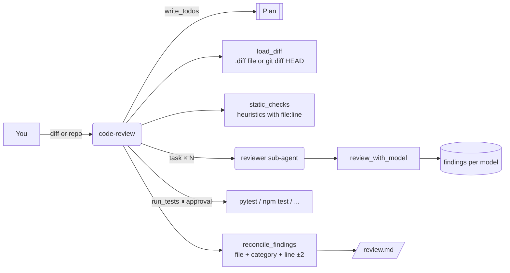

# 8 · Multi-model code review (`code-review`)

> Several models review the same diff; agreement raises confidence and one model's blind spot is covered by
> another.

A single model reviewing code misses things and sometimes invents them. This agent runs deterministic static
checks, has two or three models review the same diff independently, runs the tests, and merges everything
into one review where each finding carries a severity and a confidence (the share of models that agree).

## How it works



1. **Load** the change: a `.diff`/`.patch` file, or a git repository folder (its `git diff HEAD`, read-only).
   Added lines keep their new-file line numbers; new functions and test files are noted.
2. **Static checks** on added lines, each with `file:line`:

   | Rule | Severity | Catches |
   |---|---|---|
   | `hardcoded-secret` | critical | `api_key = "…"`, `sk-…`, `AKIA…`, private key blocks (values masked in all output) |
   | `sql-injection` | high | SQL keywords with `"…" + x`, f-strings, `.format(`, `%` formatting |
   | `tls-verify-disabled` | high | `verify=False`, `rejectUnauthorized: false`, `InsecureSkipVerify: true` |
   | `shell-injection` | high | `shell=True`, `os.system(`, `child_process.exec(` |
   | `eval-exec` | high | `eval(`, `exec(` |
   | `bare-except` | medium | `except:` |
   | `missing-test` | medium | a new public function with no test in the change that mentions it |
   | `debug-print` | low | `print(` / `console.log(` outside tests |
   | `todo` | info | TODO / FIXME |

3. **Per-model reviews**, one `reviewer` sub-agent task per model:
   - **real models** get the added lines with line numbers and must answer JSON
     (`{"findings": [{file, line, category, severity, message}]}`). Parsing is defensive: code fences,
     trailing commas, a bare array, `issues`/`comments` keys, synonyms ("SQL Injection" → `sql-injection`,
     "Major" → `high`), and as a last resort `path:line: severity: message` lines.
   - **mock models** (`SimulatedAnswerModel` candidates) produce a deterministic review derived from the
     static heuristics: each model *notices* each finding with a probability that rises with its
     `sim_skill` and the severity (`core.mock.stable_fraction`), may report it a line off, may rate it one
     level lower, and weak models may add a false positive. Different models therefore disagree in
     realistic ways, and the same model always says the same thing.
4. **Tests**: `run_tests` (approval required) runs an allow-listed command in a confined folder.
5. **Reconcile**: findings from all models and the static checks merge when **file and category match and
   lines are within ±2**. Severity is the **highest** any reviewer gave — one level lower when at most half
   the models report it and no static check backs it. **Confidence = agreeing models / models.** Static line
   numbers win (they are exact). The review, with severity sections and the test result, is written to
   `/review.md`.

## Tools

| Tool | What it does | Needs approval |
|---|---|---|
| `list_review_models()` | Catalog models available as reviewers | |
| `load_diff(source)` | Files, added/removed counts, new functions, raw diff | |
| `static_checks(source)` | Heuristic findings with file:line, secrets masked | |
| `review_with_model(model_name, source, focus)` | One model's review; stored per diff and model | |
| `reconcile_findings(source, models)` | Merge, score, write `/review.md` | |
| `run_tests(cmd, cwd, timeout_s)` | Runs the project's tests | **yes** (approve / edit / reject) |

## Sub-agents

- **reviewer**: runs one model's review (`review_with_model`) and summarizes it by severity. One task per
  model keeps each review independent.

## Human in the loop

`run_tests` executes code from the repository, so it always pauses. Safeguards:

- Allowed commands only: `pytest`, `python -m pytest` (uses the server's Python), `uv run pytest`,
  `npm test`, `npm run test`, `pnpm test`, `yarn test`, `go test`, `cargo test`, plus plain arguments.
- No shell; arguments containing `; & | $ < > \` or backticks are refused.
- `cwd` must resolve under the examples or data directory.
- Timeout (default 300 s, max 1800 s); `PYTHONDONTWRITEBYTECODE=1`; environment variables whose names
  contain KEY, TOKEN, SECRET or PASSWORD are not passed to the tests.

Rejecting it skips the tests; the review says so.

## Inputs

- `examples/code_review/sample.diff`: a realistic change to `sample_project/` with planted problems — SQL by
  string concatenation (`app/users.py:18`) and by f-string (`:28`), a hard-coded fake key
  (`app/payments.py:9`, `sk-FAKE-…`), a bare `except:` (`app/users.py:21`), `verify=False`, a debug `print`,
  and three new functions without tests.
- `examples/code_review/sample_project/`: the project before the change, with a passing pytest suite
  (`pytest.ini` keeps pytest from wandering up into this repo and disables its cache).
- A git repository: put it under the data directory (e.g. `var/repos/my-service`) and pass that folder as
  `source`; uncommitted changes against `HEAD` are reviewed.
- Stored state (data directory): `code_review/findings/<diff-id>/<model>.json`, `reconciled.json`,
  `last_test_run.json`.

## Example prompts

- "Review code_review/sample.diff with three models, run the tests and write one merged review."
- "Is there anything security-critical in code_review/sample.diff?"
- "Review the uncommitted changes in repos/my-service with nai-llama-70b and claude-haiku."

## Configuration

| Setting | Effect |
|---|---|
| `MODEL_CATALOG` | Reviewer candidates (the mock run uses the three most expensive) |
| `APP_DATA_DIR` | Stored reviews; repositories under it can be reviewed |
| `LINE_TOLERANCE`, `ALLOWED_TEST_COMMANDS`, `RULES` in `tools.py` | Merge window, test allowlist, static rules |

## With real models

Mix providers so the reviewers don't share blind spots — e.g. two endpoints on Nutanix Enterprise AI and one
cloud model:

```yaml
models:
  - {name: nai-llama-70b, provider: openai_compatible, model: llama-3-3-70b,
     base_url: https://nai.example.com/api/v1, api_key_env: NAI_API_KEY}
  - {name: nai-qwen-coder, provider: openai_compatible, model: qwen3-coder-30b,
     base_url: https://nai.example.com/api/v1, api_key_env: NAI_API_KEY}
  - {name: claude-haiku, provider: anthropic, model: claude-haiku-4-5, api_key_env: ANTHROPIC_API_KEY,
     input_per_mtok: 1.0, output_per_mtok: 5.0}
```

```bash
export MODEL_CATALOG=./my-models.yaml LLM_PROVIDER=openai_compatible LLM_BASE_URL=https://nai.example.com/api/v1
uv run nai-agents run code-review "Review code_review/sample.diff with nai-llama-70b, nai-qwen-coder and claude-haiku"
```

Reviewer models are called at temperature 0. Large diffs are truncated at 60,000 characters.

## Limits and ideas

- Static checks are regexes over added lines, not a parser: they are a deterministic floor, not a SAST tool.
  Run Semgrep/Bandit/CodeQL in CI as well.
- Context is the added lines only; reviewers don't see the rest of the file.
- Ideas: post the merged review as PR comments, give each model a different focus (security, correctness,
  tests), weight confidence by each model's historical precision, and feed the reviewed diff to the fleet
  manager (7) to fix what was found.
