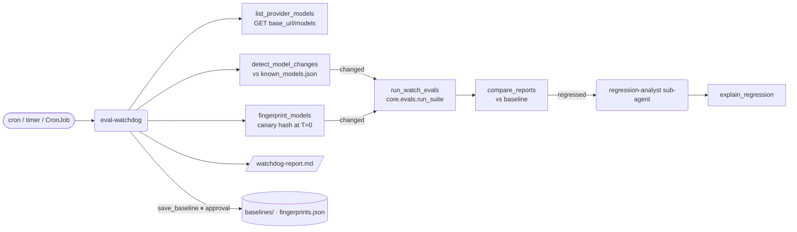

# 9 · Eval watchdog (`eval-watchdog`)

> Notice when a model changes — a new version, or a silent update behind the same name — and catch
> regressions before your users do.

Providers ship new versions and sometimes change a model without renaming it: a new quantization, a different
system prompt, a decoding change. Your evals passed last month; do they still? The watchdog compares the
provider's model listing with the last one it saw, fingerprints each model's behaviour with canary prompts,
re-runs your eval suite on whatever changed and reports regressions case by case.

## How it works



1. **Listing**: `list_provider_models` calls `GET {LLM_BASE_URL}/models` for OpenAI-compatible providers
   (Nutanix Enterprise AI, vLLM, LiteLLM, OpenAI). In mock mode it reads the last snapshot in
   `examples/eval_watchdog/model_snapshots.json`.
2. **New and removed models**: `detect_model_changes` compares the listing with
   `<data dir>/eval_watchdog/known_models.json` (on the first run: the previous snapshot, or nothing for a
   real provider, so everything listed is "new").
3. **Silent updates**: `fingerprint_models` asks each model the canary prompts
   (`examples/eval_watchdog/canaries.yaml`) at temperature 0 and hashes the answers (SHA-256, 16 hex chars).
   A different hash than the accepted one, under the same name, is a silent update. In mock mode the
   snapshot's `silent_updates` change a model's `sim_version` (and here its `sim_skill`), which changes its
   answers exactly as a real update would.
4. **Re-run evals** on the changed models with `run_watch_evals` (`core.evals.run_suite`), compared with each
   model's baseline by `core.evals.compare_reports`: **regressed** when the pass rate drops more than 5
   points or a category drops more than 10. Results list **newly failing** and newly passing case ids. A
   model without a baseline is reported as new.
5. **Explain**: the `regression-analyst` sub-agent calls `explain_regression`: every flipped case with its
   category and both outputs.
6. **Report** to `/watchdog-report.md`, also saved as `eval_watchdog/last_check.json` in the data directory
   for scripts and alerts.
7. **Re-baseline only with approval**: `save_baseline` makes the latest run the new reference, records the
   current fingerprint and marks the model as known. The agent proposes it only for new models that pass or
   changes you accept — never for a regression on its own.

## Tools

| Tool | What it does | Needs approval |
|---|---|---|
| `list_provider_models()` | The provider's current listing (API or snapshot) | |
| `detect_model_changes()` | Added / removed models vs. the last known listing; catalog models no longer listed | |
| `fingerprint_models(models)` | Canary fingerprint per model vs. accepted; `changed` list | |
| `run_watch_evals(models, suite_path)` | Eval run + baseline comparison per model; `regressions` list | |
| `explain_regression(model_name)` | Case-by-case flips between baseline and latest run | |
| `save_baseline(model_name)` | Latest run → baseline, fingerprint accepted, model marked known | **yes** (approve / reject) |

## Sub-agents

- **regression-analyst**: explains one model's regression (categories that got worse, telling examples, a
  hypothesis). Tool: `explain_regression`.

## Human in the loop

Only `save_baseline` changes state that future runs depend on, so it pauses. On a schedule run with `--no`:
the check and the report happen, nothing is re-baselined, and a human decides later in the UI.

## Inputs and state

| File | Format |
|---|---|
| `examples/eval_watchdog/model_snapshots.json` | `{snapshots: [{taken_at, models: [{id, created, ...}]}], silent_updates: {model: {sim_version, sim_skill, note}}}` — mock only. New models may carry catalog fields (`sim_skill`, prices, `context_window`) |
| `examples/eval_watchdog/canaries.yaml` | An eval suite (same format as `examples/evals/*.yaml`); `expected` is only used by simulated models |
| `examples/eval_watchdog/baselines/<model>.json` | Shipped initial baselines: a full eval report (`core.evals.report_to_dict`) plus `suite_path`, `sim_version`, `at` |
| `examples/eval_watchdog/fingerprints.json` | Shipped accepted fingerprints `{model: {fingerprint, canaries, at}}` |
| `<data dir>/eval_watchdog/...` | `known_models.json`, `fingerprints.json`, `baselines/`, `last_runs/`, `last_check.json`, `fingerprint_history.json` — these override the shipped files |

The sample data simulates: a new model `mock-medium-2026-10` in this week's listing, and `mock-small` moved
to a quantized build (`2026-10-18-q4`) — its fingerprint changes and its pass rate drops from 72% to 50%.

To regenerate the shipped baselines after changing the catalog or the suite:

```bash
uv run python -c "from pathlib import Path; from nai_agents.agents.eval_watchdog.tools import write_shipped_baselines; write_shipped_baselines(Path('examples/eval_watchdog'))"
```

## Example prompts

- "Check our models for new versions and silent updates, re-run the evals on anything that changed and report
  regressions."
- "Has mock-small changed since last week? Fingerprint it and compare with the baseline."
- "List the models our provider serves right now."

## Configuration

| Setting | Effect |
|---|---|
| `LLM_PROVIDER`, `LLM_BASE_URL`, `LLM_API_KEY` | Which `/models` endpoint is listed (OpenAI-compatible) |
| `MODEL_CATALOG` | The models fingerprinted by default |
| `APP_DATA_DIR` | Baselines, fingerprints and check results |
| `TOLERANCE` (0.05) in `tools.py` | Regression threshold (category threshold is twice that) |

## With real models (Nutanix Enterprise AI / OpenAI-compatible)

```bash
export LLM_PROVIDER=openai_compatible
export LLM_BASE_URL=https://nai.example.com/api/v1
export LLM_API_KEY=...                       # read from a secret, never committed
export LLM_MODEL=llama-3-3-70b               # the watchdog's own model
export MODEL_CATALOG=/etc/nai-agents/models.yaml
uv run nai-agents run eval-watchdog "Check for new and silently updated models and report regressions" --no
```

On the first real run every listed model is new and has no baseline: approve `save_baseline` for the models
you trust (or run with `--yes` once) to set the reference. Use your own eval suite (`suite_path`) with prompts
from real traffic; the sample suite is only a demo. Pick canaries whose answers are stable at temperature 0;
if a provider is non-deterministic even at T=0, fingerprints will flap — then rely on eval deltas only.

## Running it on a schedule

The run prints its final answer to stdout and saves `eval_watchdog/last_check.json`; `--no` rejects every
approval so nothing is re-baselined unattended. Exit code is non-zero only on errors — alert on
`regressions` in `last_check.json`.

**cron** (every day at 06:15):

```cron
15 6 * * * cd /opt/nai-deep-agents && /usr/local/bin/uv run nai-agents run eval-watchdog "Check for new and silently updated models, re-run evals and report regressions" --no >> /var/log/nai-watchdog.log 2>&1
```

Alert from the result, e.g. in the same crontab line or a follow-up script:

```bash
jq -e '.regressions | length == 0' /opt/nai-deep-agents/var/eval_watchdog/last_check.json \
  || curl -fsS -X POST "$SLACK_WEBHOOK" -d '{"text":"Eval watchdog: regression detected"}'
```

**systemd timer**:

```ini
# /etc/systemd/system/nai-watchdog.service
[Unit]
Description=NAI eval watchdog
[Service]
Type=oneshot
WorkingDirectory=/opt/nai-deep-agents
EnvironmentFile=/etc/nai-agents/env          # LLM_*, APP_DATA_DIR, MODEL_CATALOG
ExecStart=/usr/local/bin/uv run nai-agents run eval-watchdog "Check for new and silently updated models, re-run evals and report regressions" --no

# /etc/systemd/system/nai-watchdog.timer
[Unit]
Description=Run the NAI eval watchdog daily
[Timer]
OnCalendar=*-*-* 06:15:00
Persistent=true
[Install]
WantedBy=timers.target
```

`systemctl enable --now nai-watchdog.timer`

**Kubernetes CronJob** (the data directory must be a persistent volume so baselines survive):

```yaml
apiVersion: batch/v1
kind: CronJob
metadata: {name: nai-eval-watchdog}
spec:
  schedule: "15 6 * * *"
  concurrencyPolicy: Forbid
  jobTemplate:
    spec:
      backoffLimit: 1
      template:
        spec:
          restartPolicy: Never
          containers:
            - name: watchdog
              image: ghcr.io/your-org/nai-deep-agents:latest
              args: ["nai-agents", "run", "eval-watchdog",
                     "Check for new and silently updated models, re-run evals and report regressions", "--no"]
              envFrom:
                - secretRef: {name: nai-agents-llm}        # LLM_PROVIDER, LLM_BASE_URL, LLM_API_KEY
              env:
                - {name: APP_DATA_DIR, value: /data}
                - {name: MODEL_CATALOG, value: /config/models.yaml}
              volumeMounts:
                - {name: data, mountPath: /data}
                - {name: config, mountPath: /config}
          volumes:
            - name: data
              persistentVolumeClaim: {claimName: nai-agents-data}
            - name: config
              configMap: {name: nai-agents-models}
```

## Limits and ideas

- One run per case: a 1-case flip on a small suite is noise. Use suites with dozens of cases per category,
  or repeat runs, before acting on small deltas.
- `/models` listings rarely carry version details; fingerprints are what catch same-name changes.
- Ideas: alert webhooks built in, latency and cost regressions as first-class signals, pinning a route
  in the cost router (1) back to a known-good model automatically (behind approval), and a history chart of
  pass rate per model over time.
