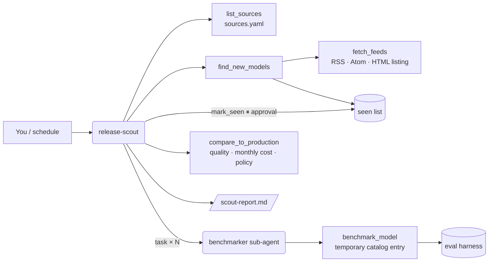

# 10 · New-model release scout (`release-scout`)

> Watch release feeds and model hubs, benchmark what's new on your own evals, and say whether to switch.

New models land every week. Most are not worth a migration; a few are cheaper at the same quality or better
at the same price. The scout reads providers' release feeds (RSS, Atom) and model-hub listings, picks out
genuine new model releases you haven't seen, extracts what the post says (context window, price),
benchmarks each on your eval suite, compares cost and quality with your production model and recommends
**switch** or **hold** with reasons.

## How it works



1. **Sources** (`examples/release_scout/sources.yaml`): each has a `type` (`rss`, `atom`, `html`), a `url`,
   and a local `sample`. In mock mode the sample is read; otherwise the URL is fetched.
2. **Find new models**: `find_new_models` parses every feed and keeps only model releases:
   - titles like "Introducing X", "X is now available", "X: …", where X carries a version number;
   - not posts about policy, recaps, red-teaming, hiring…;
   - not quantized re-uploads on hubs (`-GGUF`, `-AWQ`, `-GPTQ`, `-MLX`, `-FP8`, …);
   - not already in the seen list (shipped `examples/release_scout/seen.json` + `<data dir>/release_scout/seen.json`).

   Metadata comes from the title and summary: provider (from the source), name and id (slug), date,
   context window ("400K token context", "context window of 500,000 tokens", "32K context") and price
   ("$2.50 per 1M input tokens and $10 per 1M output", "$0.60 / $3.00 per million input/output").
3. **Benchmark** each candidate (one `benchmarker` task per model) with `benchmark_model`, which registers a
   temporary catalog entry and runs the production eval suite:
   - **mock mode**: a simulated model whose skill is derived deterministically from its list price, or its
     parameter count for open weights ("24B"), plus a small per-name jitter;
   - **real providers**: the model id is tried on the configured endpoint with a one-line probe; if it
     isn't served there it is reported `unreachable` instead of guessed.
4. **Compare** with `compare_to_production`: the production model is re-run on the same suite; monthly cost
   = your monthly input/output Mtok × each price. Decision per candidate under the policy:
   - **switch (cheaper)**: quality at most `max_quality_drop` (2 pts) worse **and** at least
     `min_savings_pct` (15%) cheaper;
   - **switch (better)**: at least `min_quality_gain` (5 pts) better **and** at most
     `max_cost_increase_pct` (25%) more expensive;
   - the candidate must also meet the suite threshold; otherwise **hold**, with the reason.

   Open-weight models have no list price; the policy's self-hosted $/Mtok is assumed and flagged.
   The overall recommendation is the best "switch" candidate (quality first, then cost), or hold.
5. **Report** to `/scout-report.md`, then **mark_seen** (approval) so the next run skips these models.

## Tools

| Tool | What it does | Needs approval |
|---|---|---|
| `list_sources()` | Feeds, production model and switch policy | |
| `fetch_feeds(sources)` | Every item (title, link, date, summary) per source, and per-source errors | |
| `find_new_models(sources)` | Unseen model releases with metadata; what was skipped and why | |
| `benchmark_model(model_id, suite_path)` | Eval run of one candidate (simulated in mock mode) | |
| `compare_to_production(models)` | Quality and monthly cost vs. production; switch/hold per model; recommendation | |
| `mark_seen(model_ids)` | Adds ids to the seen list | **yes** (approve / edit / reject) |

## Sub-agents

- **benchmarker**: benchmarks one candidate and reports pass rate, threshold, weakest category, latency
  and price (flagging assumed prices). Tool: `benchmark_model`.

## Human in the loop

`mark_seen` changes what future runs report, so it pauses. Reject it and the same models show up next time
(useful while you're still deciding). The scout never changes routing; use the cost router (1) for that.

## Inputs

`examples/release_scout/` (all providers and models are fictional):

| File | What |
|---|---|
| `sources.yaml` | `sources[] {name, provider, type, url, sample}`, `production {model, monthly_input_mtok, monthly_output_mtok, suite}`, `policy {...}` |
| `feeds/northwind_blog.rss` | OpenAI-style blog RSS: Nova-5, Nova-5 mini, a seen Nova-4.5, two non-release posts |
| `feeds/lumen_news.atom` | Anthropic-style news Atom: Sonata 4.5, Etude 4.5, a seen Sonata 4, a policy post |
| `feeds/hf_acme_models.html` | Hugging Face-style listing: Kestrel-24B/4B-Instruct, a GGUF re-upload, a seen 7B |
| `seen.json` | Ids already seen (`nova-4.5`, `sonata-4`, `kestrel-7b-instruct`) |

Expected mock result: 6 new models; Kestrel-24B-Instruct recommended (88% cheaper self-hosted at +5.6 pts);
Sonata 4.5 is better but holds on cost.

State in the data directory: `release_scout/candidates.json`, `benchmarks/<id>.json`, `seen.json`.

## Example prompts

- "Check the release feeds for new models, benchmark them and tell me if we should switch from our
  production model."
- "Which new models were released this week, and what do they cost?"
- "Benchmark Nova-5 mini against our production model."

## Configuration

| Setting | Effect |
|---|---|
| `LLM_PROVIDER` | `mock` reads local samples and simulates benchmarks; anything else fetches feeds over http(s) |
| `sources.yaml` → `production`, `policy` | Production model and volume, switch thresholds, self-hosted prices |
| `MODEL_CATALOG` | Must contain the production model |

## With real models

```bash
export LLM_PROVIDER=openai_compatible LLM_BASE_URL=https://nai.example.com/api/v1 LLM_API_KEY=... LLM_MODEL=llama-3-3-70b
uv run nai-agents run release-scout "Check the release feeds for new models and benchmark them"
```

Point `sources` at real feeds (a provider's news RSS/Atom, a Hugging Face organization page). Candidates are
benchmarked only if the configured endpoint serves them — on Nutanix Enterprise AI, deploy the new
open-weight model as an endpoint first (its endpoint name must match the id or name), then re-run.

**Fetch safety**: only `http`/`https` URLs (also after redirects), 15 s timeout, 2 MB cap, a fixed
User-Agent, and feeds that declare XML entities are refused (no entity-expansion attacks). HTML is parsed with
the standard library `HTMLParser`; nothing is executed.

## Limits and ideas

- Release detection is pattern-based; unusual titles ("Say hello to …") may be missed and should be added to
  the patterns. The skipped list shows every decision.
- Hub listings rarely state price or context; the HTML parser reads "NNK context" when present.
- One suite, one run per case: treat small deltas as noise and shadow-test before switching.
- Ideas: provider pricing pages as a second source for prices, per-category comparisons via the cost router
  (1), opening a change request for the gateway config, and a weekly digest to Slack.
